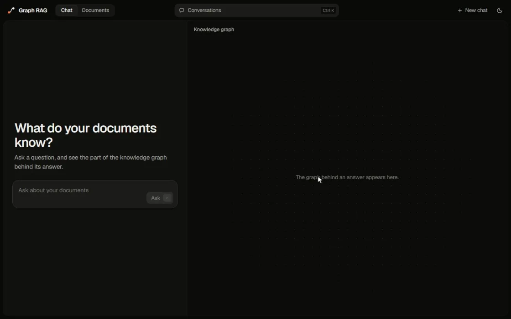
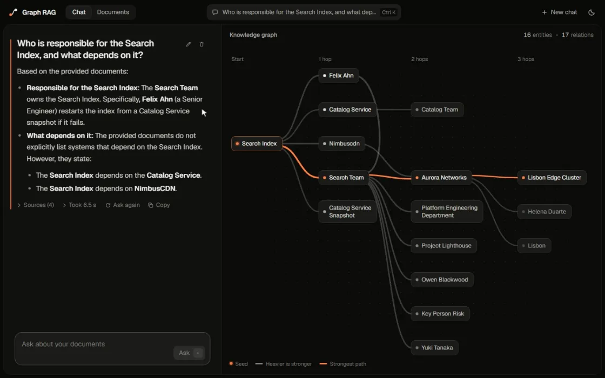
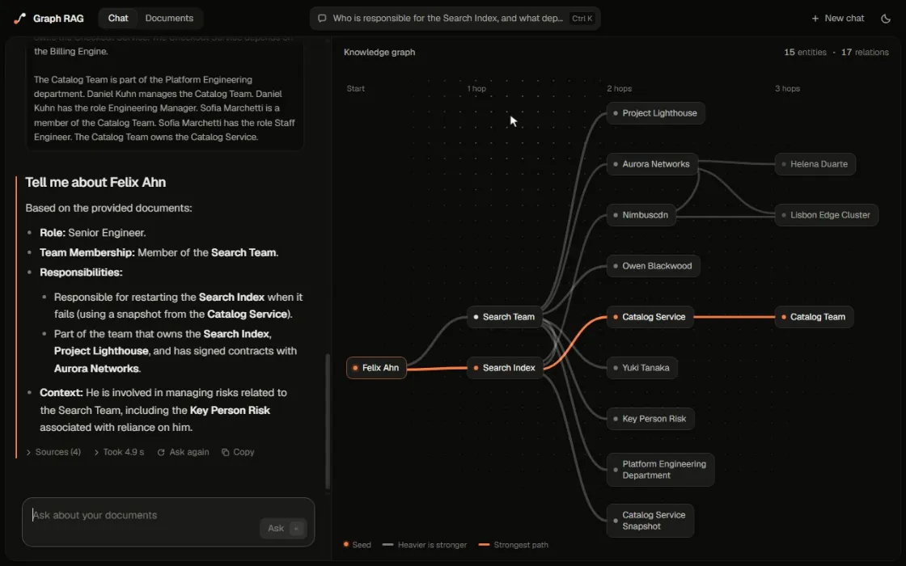
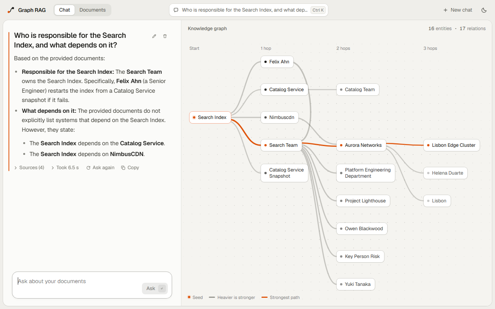
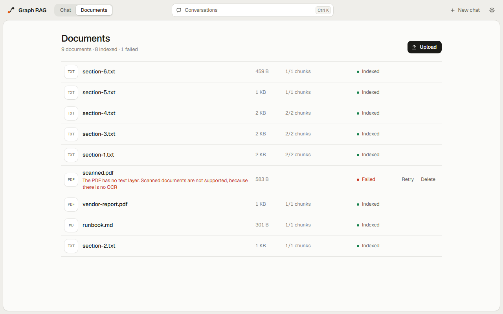

<div align="center">

# Visualized Graph RAG

**Ask questions about your documents and see the part of the knowledge graph behind each answer.**

</div>



Documents (PDF with a text layer, TXT, MD) become a knowledge graph through an LLM. A question goes through a router and a short reformulation, graph retrieval with spreading activation, and a streamed answer with its sources. The graph is drawn next to the chat as a flow from the seed outwards, a hop per column, with emphasis and line width taken from the retrieval weights.

It runs on one machine: NestJS services, React, Neo4j, Postgres and RabbitMQ in Docker, and models in Ollama or behind an OpenAI-compatible API.

## See where an answer comes from

Every relation remembers the passage it was extracted from. Point at a source to light up what it gave the graph, point at a relation to read the sentence behind it, and click a node to ask about it.



## Change your mind

A follow-up is rewritten into a short question of its own, shown above the answer. Any question can be edited, asked again or rewound to, an answer can be stopped halfway, and every turn keeps its own graph and how long each stage took.



<table>
  <tr>
    <td></td>
    <td></td>
  </tr>
</table>

## Run it

With Docker, and [Ollama](https://ollama.com) on the host:

```bash
ollama pull qwen3.5:4b
ollama pull qwen3-embedding:0.6b
docker compose up -d --build
```

Then open http://localhost:8080. Other models and providers, and what to do when something breaks, are in [docs/running.md](docs/running.md).

## More

- [docs/architecture.md](docs/architecture.md): how it works and why.
- [docs/development.md](docs/development.md): code rules, tests and commands.

## Credits

Retrieval uses QASA (Query-Aware Spreading Activation), ported to TypeScript from [kinfi4/qasa-graph-rag](https://github.com/kinfi4/qasa-graph-rag) (MIT). It is a port, not a dependency.
