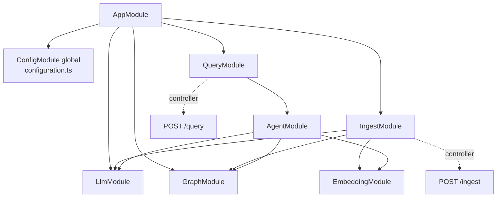
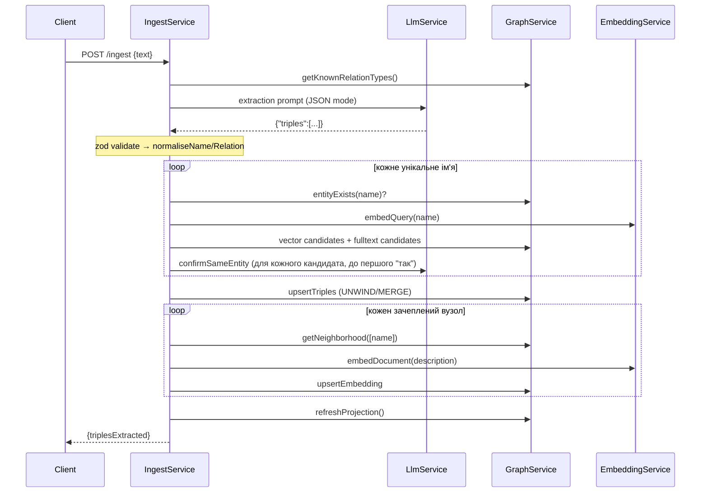
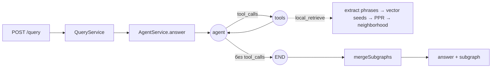

# 02. Архітектура

## Модулі NestJS і залежності



| Модуль | Сервіс | Відповідальність |
|---|---|---|
| `LlmModule` | `LlmService` | Один виклик `POST {ollama}/api/generate`, `stream:false`, опційно `format:'json'`. Використовується для **одноразових** LLM-викликів (extraction, entity-resolution confirm, витяг фраз із запитання) |
| `EmbeddingModule` | `EmbeddingService` | `POST {ollama}/api/embed`. Два публічні методи: `embedDocument` (префікс `search_document: `) і `embedQuery` (`search_query: `). Приватний `embed` |
| `GraphModule` | `GraphService` | **Єдине місце, яке говорить із Neo4j.** Driver lifecycle, індекси, всі Cypher-запити |
| `IngestModule` | `IngestService` + `IngestController` | Оркестрація: extraction → normalise → entity resolution → upsert → re-embed → refresh projection |
| `AgentModule` | `AgentService` | LangGraph-цикл, tool `local_retrieve`, власний `ChatOllama` |
| `QueryModule` | `QueryService` + `QueryController` | Тонкий фасад над `AgentService`; зберігає HTTP-контракт |

### Правило шарів

`GraphService` — **Data Access Layer** і не залежить ні від `EmbeddingService`, ні від `LlmService`. Це було прямим архітектурним аргументом автора проєкту (Stage 1, 25 вер): DAL не повинен тягнути залежності на сервіси application-рівня. Тому `IngestService` / `AgentService` самі отримують вектор від `EmbeddingService` і передають його в `GraphService` як параметр.

Є два паралельні шляхи до Ollama:

- `LlmService` — сирий `fetch` на `/api/generate` (без історії, одноразові JSON-виклики);
- `ChatOllama` з `@langchain/ollama` усередині `AgentService` — `/api/chat` з `tools`, багатокрокова історія.

Це свідоме розділення (інші бібліотеки/інша турбота), але вони читають одні й ті самі `ollama.baseUrl` та `ollama.model`.

## Модель даних у Neo4j

```
(:Entity {name, embedding[768], embeddingText, embeddingModel})
        -[:REL {type: "MANAGES"}]->
(:Entity {...})
```

- **Один label `Entity`**, без типів сутностей (Person/Team/…). Тип сутності — це лише контекст у тексті, не схема.
- **Один тип ребра `REL`**, а справжня семантика — у властивості `type` (`MANAGES`, `OWNS`, …). Причина: у Cypher тип ребра не можна передати bound parameter-ом, а ми принципово **не будуємо Cypher зі строк від LLM**. З `REL {type: t.relation}` усі запити лишаються фіксованими літералами. Дивись [06-neo4j-cypher-gds.md](06-neo4j-cypher-gds.md).
- `name` — **нормалізований** (trim, lowercase, згорнуті пробіли) і є ідентичністю вузла (`MERGE (s:Entity {name: ...})`).
- `embedding` — вектор опису вузла; `embeddingText` — текст, з якого його зроблено (потрібен для entity-resolution confirm і для виявлення зміни моделі); `embeddingModel` — назва моделі на момент embed.
- Немає вузлів `Document`/`Chunk` і немає provenance — **свідомо** відкладено (див. [03-roadmap-stages.md](03-roadmap-stages.md)).

### Індекси та проєкція

| Об'єкт | Ім'я | Створюється | Призначення |
|---|---|---|---|
| Vector index | `entity_embedding` | `GraphService.onModuleInit` (з перевіркою dimension) | seed nodes за семантикою; cosine, 768 |
| Fulltext index (Lucene) | `entity_name_fulltext` | `onModuleInit` (`IF NOT EXISTS`) | лексичні кандидати для entity resolution |
| GDS projection | `kg` | `onModuleInit` + після кожного ingest із ≥1 triple | in-memory знімок для PageRank; `Entity` + `REL`, **UNDIRECTED** |

Проєкція — **знімок, а не live view**: після зміни графа її треба перебудувати (`drop` + `create`).

## Потік даних

### Ingest



Деталі — [04-ingest-pipeline.md](04-ingest-pipeline.md).

### Query



Деталі — [05-query-and-agent.md](05-query-and-agent.md).

## HTTP-контракти

Глобальний `ValidationPipe({ whitelist: true, forbidNonWhitelisted: true, transform: true })` — зайві поля в тілі → 400.

| Метод | Тіло | Відповідь |
|---|---|---|
| `POST /ingest` | `{ "text": string (≥1 символ) }` | `{ "triplesExtracted": number }` |
| `POST /query` | `{ "question": string (≥1 символ) }` | `{ "answer": string, "subgraph": { "nodes": [{name}], "edges": [{source, relation, target}] } }` |

Порт: `process.env.PORT ?? 3000`. У сесіях тестувалось на `PORT=3111`.

Помилки: немає власних exception filters; помилка extraction (`LLM output did not match schema`) та мережеві помилки Ollama піднімаються як 500.

## Конфігурація

Усе в [`configuration.ts`](../graph-rag-api/src/config/configuration.ts), читається через `ConfigService.getOrThrow`. Env-змінні:

| Змінна | Дефолт | Для чого |
|---|---|---|
| `OLLAMA_BASE_URL` | `http://localhost:11434` | |
| `OLLAMA_MODEL` | `qwen2.5:7b-instruct` | чат/extraction/агент |
| `OLLAMA_EMBEDDING_MODEL` | `nomic-embed-text` | |
| `EMBEDDING_DIMENSION` | `768` | **має збігатися** з моделлю; інакше застосунок не стартує, якщо індекс уже створений |
| `SIMILARITY_THRESHOLD` | `0.6` | поріг релевантності seed node на query (**не калібровано**) |
| `PPR_TOP_N` | `15` | скільки вузлів із PPR лишити (**не калібровано**) |
| `ENTITY_RESOLUTION_THRESHOLD` | `0.5` | поріг кандидатів для entity resolution на ingest (**не калібровано**, практично нічого не відсікає) |
| `NEO4J_URI` / `NEO4J_USER` / `NEO4J_PASSWORD` | `bolt://localhost:7687` / `neo4j` / `graphrag-local` | збігається з `docker-compose.yml` |
| `PORT` | `3000` | |

`.env.example` містить лише першу половину цих змінних; `PPR_TOP_N`, `ENTITY_RESOLUTION_THRESHOLD` у ньому відсутні (див. [11-known-issues-and-backlog.md](11-known-issues-and-backlog.md)).

## Тестування

- `test/app.e2e-spec.ts` — єдиний тест: збирається DI-граф `AppModule` (`Test.createTestingModule(...).compile()`).
- Unit-тестів **немає** (`pnpm test` скаржиться «No test files found»).
- Уся реальна перевірка логіки робилась вручну проти живих Neo4j + Ollama (див. [09-empirical-findings.md](09-empirical-findings.md)).

## Нюанси збірки (ESM)

- Усі імпорти мають суфікс `.js` (`./graph.service.js`), навіть для `.ts`-файлів — вимога `module: nodenext`.
- `emitDecoratorMetadata` + `experimentalDecorators` для NestJS DI.
- `dist/` і `*.tsbuildinfo` в `.gitignore`.
