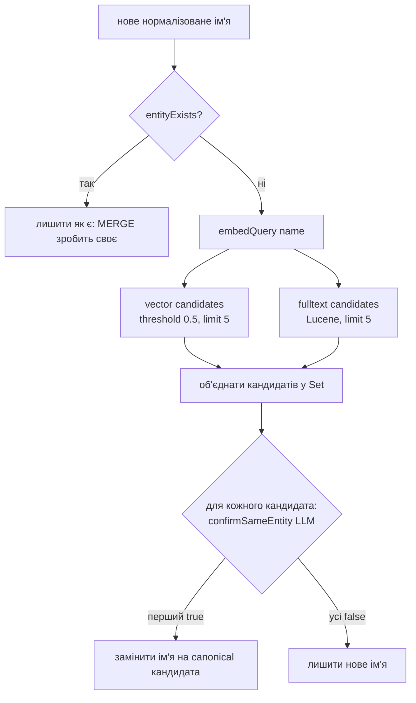

# 04. Ingest pipeline

Код: [`ingest.service.ts`](../graph-rag-api/src/ingest/ingest.service.ts), [`ingest.prompts.ts`](../graph-rag-api/src/ingest/ingest.prompts.ts), [`describe.ts`](../graph-rag-api/src/graph/describe.ts), [`normalise.ts`](../graph-rag-api/src/graph/normalise.ts).

`IngestService.ingest(text)` ([ingest.service.ts:45](../graph-rag-api/src/ingest/ingest.service.ts)) виконує 6 кроків **послідовно**.

## Крок 1. Словник relation types

`graph.getKnownRelationTypes()` → `MATCH ()-[r:REL]->() RETURN DISTINCT r.type`. Читається **свіжо щоразу** (не кешується): потрібен словник «на зараз», а не «на старт застосунку». Для першого ingest результат порожній — промпт має для цього окрему гілку.

## Крок 2. Extraction

`buildExtractionPrompt(text, knownTypes)` → `llm.generateText(prompt, { json: true })`.

Вихід валідується **двічі**:

1. `parseJsonSafe(raw)` — ніколи не кидає, повертає `null` при поганому JSON (Ollama `format:'json'` «просить», але не гарантує валідність);
2. `extractionSchema` (zod): `{ triples: [{subject, relation, object}] }`, усі рядки `min(1)`.

Якщо не пройшло — `Error('Extraction failed: LLM output did not match schema')`, граф не чіпається.

Нормалізація (спільна для всіх, `normalise.ts`):

| Функція | Правило | Приклад |
|---|---|---|
| `normaliseName` | `trim` → `lowercase` → згорнути пробіли | `"  Platform   Team "` → `"platform team"` |
| `normaliseRelation` | `trim` → `UPPERCASE` → пробіли в `_` | `"reports to"` → `"REPORTS_TO"` |

> Нормалізація ловить регістр і пробіли. **Синоніми** (`MANAGES` vs `IS_MANAGER_OF`) вона не ловить — для цього словник у промпті.

### Дизайн extraction-промпту (v1)

Кожне правило з'явилось після конкретного збою v0 на `qwen2.5:7b-instruct` (історія — у коментарі до функції):

| Правило промпту | Який збій v0 його спричинив |
|---|---|
| Сутність ≤ 4 слів + контрприклад «без дієслів» | v0 породив вузол `senior_engineer_on_platform_team` — цілий предикат як одна сутність |
| Заборона розмитих relations (`IS`, `HAS`, `RELATED_TO`, `ASSOCIATED_WITH`) | v0 видав relation `IS` |
| Атомарність — один факт на triple | v0 схлопнув речення з двох фактів в один triple |
| «Natural form, без underscore» для сутностей | v0 вигадував snake_case імена; нормалізація — справа коду, не моделі |
| Active voice | v0 мішав `OWNS`/`OWNED_BY` → фрагментація словника й плутанина напрямку |
| **Few-shot приклад** | найсильніший важіль: показує декомпозицію role/membership, розв'язання займенників, багато triples з одного речення. Приклад навмисно з іншого домену (Olena/Petro/Atlas guild), щоб модель не копіювала його в реальний вихід |

Додатково: «use only what the text states», «return `{triples: []}` якщо фактів немає».

### Блок словника в промпті (Stage 3.1)

- Якщо `knownTypes` не порожній: «Reuse one of these whenever it genuinely fits… do not write `IS_MANAGER_OF` if `MANAGES` is already in the list… Only introduce a new type when none fit».
- Якщо порожній: «No relation types exist yet — this is the first document».

**Чому soft enforcement, а не JSON-schema enum:** (1) Ollama `format:'json'` тут не grammar-constrained decoding; (2) жорсткий enum **назавжди заблокував би** появу справді нового типу. Новий тип від моделі просто записується в граф і стає «відомим» наступному ingest.

**Ціна такого підходу** (видно в тестах): повторне використання типу іноді «натягується» на неправильний сенс — наприклад `cloudscale -[OWNS]-> infrastructure team` з речення «CloudScale provides infrastructure for the Infrastructure team».

## Крок 3. Entity resolution

`resolveEntityNames(triples)` → для кожного **унікального** імені (не для кожного triple) викликає `resolveEntityName`:

Важливі властивості:

- **Short-circuit на точний збіг** — `MERGE` уже правильно обробляє цей випадок, тож вартісний шлях (embedding + 2 пошуки + LLM) запускається лише для «нових на вигляд» імен.
- **Два незалежні сигнали кандидатів**, не злиті в один score: оцінка Lucene і cosine не на порівнюваних шкалах. Обидва просто годують один і той самий крок підтвердження.
- **Fulltext — токенізований збіг, не fuzzy (`~`)** — свідомо. Токенізація вже знаходить «Acme Corp» за «Acme». Опечатки відкладені до реального випадку. Перед пошуком запит проходить `escapeLuceneQuery` (імена на кшталт `R&D`, `C++` інакше зламали б парсинг Lucene).
- **Підтвердження — LLM yes/no** (`buildEntityResolutionPrompt`) з *асиметричним* контекстом: у нового імені ще немає ребер, тому воно подається голим, а в кандидата — його `embeddingText` (факти з реальних ребер). «Acme Corp» vs «Acme Industries» по двох голих рядках не розрізнити; по фактах є шанс.
- **Fail-closed:** якщо відповідь LLM зламана або не проходить zod (`{sameEntity: boolean}`) — вважати «не те саме». Помилкове злиття гірше за дубль (на відміну від extraction, де безпечним дефолтом був порожній результат). Промпт теж каже: «When genuinely unsure, answer false».
- **Окремий поріг** `entityResolution.candidateSimilarityThreshold = 0.5` — не той, що `similarityThreshold` на query. Питання інше («чи це та сама сутність» vs «чи достатньо релевантно для відповіді»), ціна помилки інша. Поріг навмисно м'який: це лише фільтр кандидатів, рішення приймає LLM. На практиці він майже нічого не відсікає (див. [09](09-empirical-findings.md)); реальне обмеження дає `limit = 5` на кожне джерело.
- `confirmSameEntity` викликається **послідовно**, зупиняється на першому «так».

### Спостереження з читання коду (не окремо перевірено)

- Resolution порівнює нові імена лише з тим, що **вже є в графі**; варіанти в межах одного документа («Acme» і «Acme Corp» в одному тексті) між собою не зливаються, бо `upsertTriples` відбувається після всього resolution.
- Resolution виконується до `upsertTriples`, а їхній результат не транзакційний разом: див. «Атомарність» в [11](11-known-issues-and-backlog.md).

## Крок 4. Upsert

`graph.upsertTriples(triples)` — один запит `UNWIND $triples ... MERGE (s:Entity {name}) MERGE (o:Entity {name}) MERGE (s)-[:REL {type}]->(o)`. Повторний ingest того самого факту **не дублює** ребро (MERGE за `type`).

## Крок 5. Re-embedding зачеплених вузлів

Для кожного імені, що фігурує в нових triples (`touchedNames`):

1. `getNeighborhood([name])` — **усі поточні** ребра вузла, не лише додані зараз;
2. `buildEntityDescription(name, edges)` → `"name source rel target. source rel target. ..."`;
3. `embedDocument(description)` (префікс `search_document: `);
4. `upsertEmbedding(name, vector, description, modelName)`.

**Чому з усіма поточними ребрами:** embedding вузла має відображати все, що про нього відомо, інакше другий документ з одним новим фактом залишив би вузол знаходимим лише за змістом першого.

**Чому опис будує код (а не LLM):**

- детермінований і безкоштовний (без додаткових LLM-викликів) → можна перераховувати при кожному ingest;
- **не може вигадати факт**, якого немає в ребрі — критично для explainability;
- слова для relation беруться механічно (`MEMBER_OF` → «member of»), без таблиці вербалізації, бо словник відкритий;
- напрямок лишається як витягнуто (subject → object) навіть коли `name` — object: embedding-моделі потрібні правильні слова поруч, а не граматична краса.

Альтернативу «A» (опис пише LLM) відхилено як повільнішу/дорожчу й таку, що може галюцинувати; може повернутись, якщо якість embeddings виявиться недостатньою.

Виконується **послідовно** — одна локальна модель на одній машині, паралельні виклики лише стали б у чергу; плюс простіше знайти вузол, на якому впало.

## Крок 6. Оновлення GDS-проєкції

Лише якщо `triples.length > 0`: `graph.refreshProjection()`. Знімок має перебудовуватись після будь-якої зміни структури — так само, як embedding після зміни змісту.

## Вартість і швидкість

На M1 Air + `qwen2.5:7b-instruct` (виміри 12 жовтня, 20 малих документів): **5.8–61 с на документ, ~10 хв сумарно**. Нерівність пояснюється кількістю нових імен: кожне нове ім'я — embedding + 2 пошуки + до ~10 LLM-підтверджень (5 vector + 5 fulltext, з дублями). Тому ingest — кандидат на фонову чергу (Stage 6).

## Результат

`{ triplesExtracted: <кількість triples після resolution> }`.
