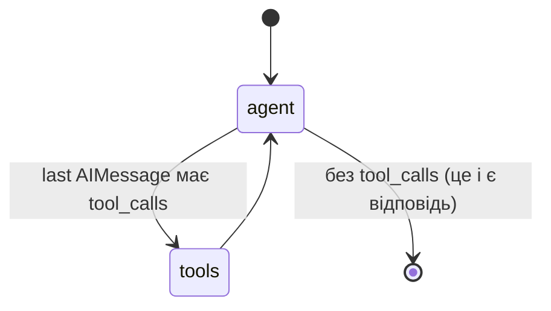
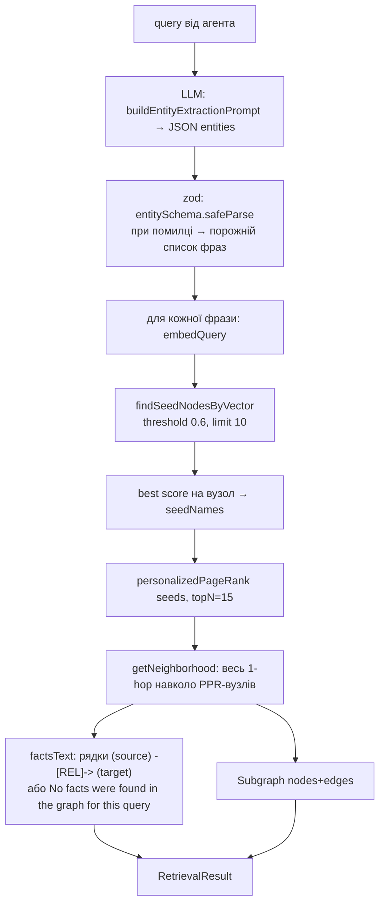

# 05. Query і агентний шар (Stage 4)

Код: [`agent.service.ts`](../graph-rag-api/src/agent/agent.service.ts), [`agent.state.ts`](../graph-rag-api/src/agent/agent.state.ts), [`agent.prompts.ts`](../graph-rag-api/src/agent/agent.prompts.ts), [`merge-subgraphs.ts`](../graph-rag-api/src/graph/merge-subgraphs.ts), [`query.prompts.ts`](../graph-rag-api/src/query/query.prompts.ts), [`query.service.ts`](../graph-rag-api/src/query/query.service.ts).

## Що змінилось порівняно зі Stage 0–2

| До Stage 4 | Після Stage 4 |
|---|---|
| `QueryService.query()` — **фіксована** послідовність: extract phrases → seed nodes → PPR → `getNeighborhood` → generate answer | Та сама послідовність (без останнього кроку) стала **тілом одного tool** `local_retrieve`, який LLM викликає 0, 1 або N разів |
| Один retrieval → один підграф | N retrieval → N підграфів → об'єднання |
| Окремий LLM-виклик «згенеруй відповідь» (`buildAnswerPrompt`) | Окремого виклику немає: **останнє повідомлення агента і є відповідь**. Правило grounding переїхало в system prompt |
| `QueryService` має всю логіку | `QueryService` — тонкий фасад над `AgentService.answer()`; HTTP-контракт не змінився |

## Граф станів LangGraph



Реєстрація — у конструкторі ([agent.service.ts:120](../graph-rag-api/src/agent/agent.service.ts)):

```ts
new StateGraph(AgentStateAnnotation)
  .addNode('agent', this.callModel.bind(this))
  .addNode('tools', this.executeTools.bind(this))
  .addEdge(START, 'agent')
  .addConditionalEdges('agent', this.shouldContinue.bind(this), { tools: 'tools', [END]: END })
  .addEdge('tools', 'agent')
  .compile();
```

- Граф **компілюється один раз** у конструкторі й перевикористовується; кожен `.invoke()` має власний незалежний state, тож це безпечно при паралельних запитах.
- `.bind(this)` потрібен, бо `addNode` лише зберігає посилання на функцію; рушій потім викличе її як `fn(state)`, і без `bind` `this` усередині було б `undefined`.
- **Хто що викликає:** `callModel` / `shouldContinue` / `executeTools` — тіла вузлів/ребер, їх запускає **рушій LangGraph** під час `.invoke()`. `localRetrieveTool` — **не вузол**; LangGraph про нього не знає. Його викликає наш власний код — один рядок усередині `executeTools`.
- `answer()` викликає граф з `recursionLimit: 10` — обмеження кількості кроків (в термінах Module 5 — `max_steps`); перевищення дає `GraphRecursionError`, а не нескінченний цикл.

### State

```ts
AgentStateAnnotation = Annotation.Root({
  ...MessagesAnnotation.spec,           // messages з вбудованим reducer (append / replace-by-id)
  subgraphs: Annotation<Subgraph[]>({
    reducer: (existing, update) => existing.concat(update),
    default: () => [],
  }),
});
```

**Reducer** каже, як злити *наявне* значення поля з *шматком*, який повернув вузол. Без reducer кожне `{ subgraphs: [...] }` **замінювало б** попереднє значення — після другого виклику tool залишився б тільки останній підграф. Вузол, який поле не повернув (напр. `callModel`), reducer для нього не запускає — значення лишається.

Прохід на запитанні «Compare Platform and Growth»: `[]` → (tools, call 1) `[sgPlatform]` → (callModel нічого не повертає для `subgraphs`) `[sgPlatform]` → (tools, call 2) `[sgPlatform, sgGrowth]`.

Reducer — просте приєднання, **не merge**. Дедуплікація — окрема справа, `mergeSubgraphs`, що виконується один раз після завершення графа.

## Tool `local_retrieve`

```ts
name: 'local_retrieve'
description: 'Searches the knowledge graph for facts relevant to a focused query about ONE subject.
              Call it once per distinct subject a question asks about — never once for a question covering several subjects.'
schema: z.object({ query: z.string() })     // "A focused natural-language query about one subject."
```

Тіло — `retrieveForAgent(query)` ([agent.service.ts:212](../graph-rag-api/src/agent/agent.service.ts)):



### Чому витяг фраз залишився всередині tool

Спершу вважали, що агент «поглине» окремий LLM-виклик витягу сутностей (він же сам формулює query). Це було **хибне припущення**: vector search працює по **фразах**, а не по цілому реченню — службові слова («who», «в нашому…») розмивають вектор. Тому агент формулює природний запит, а витяг фраз лишається внутрішньою деталлю tool-а. Правила цього промпта (v1) — у коментарі до `buildEntityExtractionPrompt`: v0 повертав `{"entities": []}` на «Who is responsible for billing?», бо перелік «person, team, system, concept» якорив модель на власні назви; приклади з «billing», «onboarding» зламали якір. Правило «при сумніві — ВКЛЮЧАЙ: ключ, що нічого не знайшов, нічого не коштує; пропущений ключ губить відповідь».

### Два типи результату

`RetrievalResult = { factsText, subgraph }`:

- `factsText` — те, що читає модель (текст у `ToolMessage`);
- `subgraph` — структурований об'єкт, який іде **повз модель** в state для explainability.

## `executeTools` — чому вручну, а не `ToolNode`

Свідомий вибір ([agent.service.ts:165](../graph-rag-api/src/agent/agent.service.ts)): prebuilt `ToolNode` вміє перетворити return tool-а лише на **текст** `ToolMessage`. Маршрутизувати ще й структурний `Subgraph` в окреме поле state з ним немає вбудованого шляху (є «content_and_artifact», але це неперевірена фіча). Рукописний вузол — прозоріший, а при одному tool диспетчеризація — кілька рядків.

Також у вузлі:

- `call.name !== 'local_retrieve'` → `ToolMessage('Unknown tool "…"')`, а не падіння (модель в принципі може вигадати назву tool);
- `localRetrieveTool.invoke(call.args)` — **саме `call.args`, не `call`** (див. пастку нижче).

### Пастка `tool.invoke()`: аргументи vs ToolCall

Спершу `executeTools` **обходив** tool і викликав `retrieveForAgent` напряму — тіло функції в `tool(...)` ніколи не виконувалось і лише слугувало «паспортом» для `bindTools`. Від автора проєкту надійшло пряме питання: чому не слідувати конвенції LangGraph. Перевірено живцем:

| Виклик | Що повертає |
|---|---|
| `tool.invoke({ query: '...' })` (прості args) | **Рівно те, що повернула функція**, включно зі складним об'єктом `{ factsText, subgraph }` |
| `tool.invoke(fullToolCall)` (`{name, args, id, type}`) | LangChain **сам обгортає** результат у `ToolMessage` з `content = JSON.stringify(увесь об'єкт)` → сирий JSON підграфа потрапив би в «факти» для моделі |

Тепер код ходить через справжній tool і передає `call.args`. Це не декорація: функція в `tool()` — реальний шлях виконання.

### Типи: zod v4 vs `@langchain/core` 0.3

Верхній рівень проєкту — zod v4, а `tool()` в `@langchain/core@0.3.x` типізований під типи zod v3. Підтверджено: схема v4 коректно працює в рантаймі через `bindTools()` + Ollama, але TS не зіставляє її з v3-перевантаженням і падає на `unknown`-варіант. Тому функція tool приймає `input: unknown` і парсить `localRetrieveSchema.parse(input)` у тілі. Побічний плюс: некоректний tool call від моделі дає реальну помилку валідації, а не мовчазний `undefined`.

## System prompt

[`buildSystemPrompt()`](../graph-rag-api/src/agent/agent.prompts.ts) — п'ять правил:

1. Ніколи не відповідати зі своїх знань; кожне твердження — з результату `local_retrieve`.
2. Запитання про кілька предметів («compare X and Y») → окремий `local_retrieve` на кожен, ніколи не один комбінований.
3. Query — короткий, про ОДИН предмет, не перефразоване все питання.
4. Немає релевантних фактів → прямо сказати «не знаю цієї частини», не вгадувати.
5. Коли достатньо — перестати викликати tool і дати відповідь простим текстом.

Системного правила про «кілька фактів про один предмет» (на відміну від «кілька предметів») немає — див. over-decomposition у [11](11-known-issues-and-backlog.md).

## `mergeSubgraphs`

Об'єднує підграфи з усіх викликів за один turn; дедуплікує вузли за `name`, ребра — за `source|relation|target`. Виконується один раз у `answer()`. Саме тому у відповіді на compare-запитання є вузли **обох** сторін.

> Спостереження (29 жовтня, лише аналіз, код не міняли): функція кладе в результат **ті самі об'єкти**, що лежать у `AgentState.subgraphs`, а не копії. Зараз ніхто не мутує після merge, але межа «внутрішній стан агента ↔ DTO назовні» не захищена. Пропозиція: `readonly`/`ReadonlyArray` у `graph.types.ts` та `nodes.push({ ...node })`. Решта кодової бази (graph.service, `resolveEntityNames`, DTO) вже будує нові об'єкти.

## Спайк `langgraph-local-test` (14 жовтня)

Перш ніж будувати дизайн Stage 4 навколо LangGraph, окремо перевірили **фундамент** — чи `ChatOllama.bindTools()` + `qwen2.5:7b-instruct` надійно видає tool calls. Принцип той самий, що в усьому проєкті: розділити «чи працює механізм» (шар 1: здатність моделі) і «чи правильна наша оркестрація» (шар 2: граф), щоб баг потім одразу мав адресу.

| Скрипт | Що перевіряє | Результат |
|---|---|---|
| `index.ts` | Низькорівневий `StateGraph` + `ToolNode`; tool повертає вигадане ім'я «Zorak Vell» для команди Nimbus, яке модель не могла вгадати | **PASS** — модель викликала tool, результат повернувся, у відповіді точне ім'я |
| `second-question.ts` | «What is the capital of France?» при наявному tool | **PASS** — tool не викликано, модель відповіла напряму |
| `high-level.ts` | Те саме через `createReactAgent` | **PASS** — структурно той самий граф, лише менше коду |

Дизайн тесту (вигадане, невгадуване значення) сильніший за ідею з `add(a, b)`: арифметику модель могла б порахувати сама, і тест нічого б не довів про tool calling.

**Свідомо НЕ перевірялось спайком:** послідовні виклики одного tool (декомпозиція) і вибір між кількома tools. Це перевірив уже Stage 4 (див. [10](10-test-corpus-and-evaluation.md)).

## Як спостерігати, що зробив агент

Текст відповіді не доводить кількість retrieval. Debug-рядок у логу сервера — по одному на кожен виклик tool:

```
local_retrieve("risks facing the Search Team") -> seeds=["search team", ...] facts=12
```

Рахуй ці рядки на кожне запитання. Деталі — [12-runbook.md](12-runbook.md).
